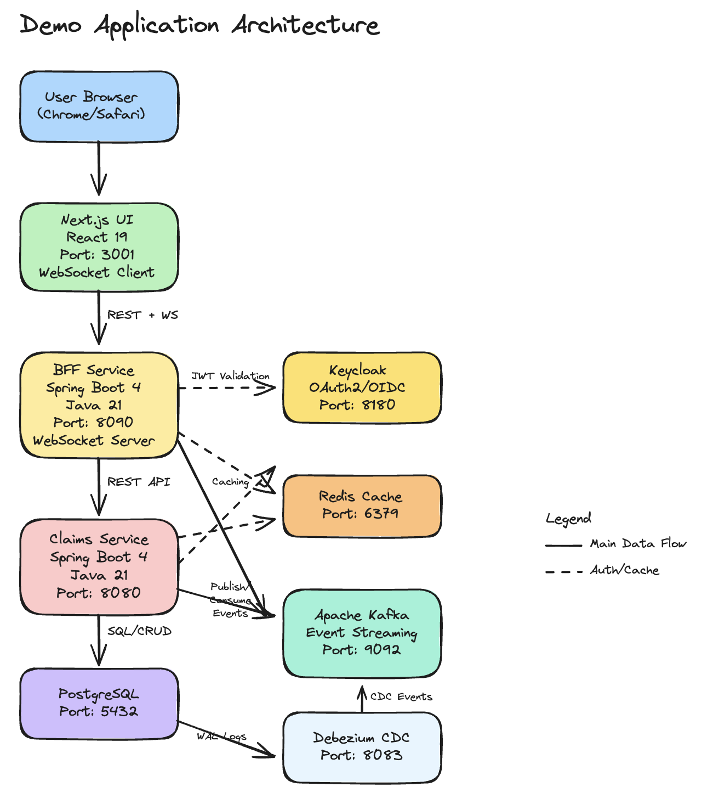

# Demo App — Insurance Claims Management

A three-tier microservices application used as a QA assessment platform. The app is fully functional and ships with unit tests. The QA team's task is to extend test coverage across all layers — integration, contract, E2E, load, and beyond.

---

## Architecture



| Tier | Technology | Port |
|------|-----------|------|
| UI | Next.js 16 + React 19 | 3001 |
| BFF | Spring Boot 4 + Java 21 | 8090 |
| Claims Service | Spring Boot 4 + Java 21 | 8080 |
| Auth | Keycloak 26 (OAuth2/OIDC) | 8180 |
| Database | PostgreSQL 15 | 5432 |
| Cache | Redis 7 | 6379 |
| Event Streaming | Apache Kafka | 9092 |
| Kafka UI | provectuslabs/kafka-ui | 9093 |
| CDC (optional) | Debezium 2.4 | 8083 |

See [ARCHITECTURE.md](ARCHITECTURE.md) for full details.

---

## Prerequisites

| Tool | Min version | Check | Install |
|------|-------------|-------|---------| 
| **Docker Desktop** | 24+ | `docker --version` | https://docs.docker.com/get-docker/ |
| **Java (JDK)** | 21 | `java -version` | https://adoptium.net |
| **Maven** | 3.9+ | `mvn -version` | https://maven.apache.org/download.cgi |
| **Node.js** | 20+ | `node --version` | https://nodejs.org |

> **macOS:** `brew install --cask docker && brew install temurin@21 maven node`

---

## Quick Start

```bash
./start-infra.sh   # Start PostgreSQL, Kafka, Redis, Keycloak
./start-app.sh     # Build JARs + start Claims Service, BFF, UI
```

> First run: ~2–3 min (image downloads). Subsequent starts: ~30 seconds.

### URLs

| What | URL | Credentials |
|------|-----|-------------|
| **Demo App UI** | http://localhost:3001 | See test users below |
| BFF Swagger | http://localhost:8090/swagger-ui.html | — |
| Claims Swagger | http://localhost:8080/swagger-ui.html | — |
| Keycloak Admin | http://localhost:8180 | `admin` / `Admin123!` |
| Kafka UI | http://localhost:9093 | — |

### Test Users

| Role | Username | Password |
|------|----------|----------|
| Admin | `admin@demo.com` | `Admin123!` |
| Claimant | `claimant@demo.com` | `Claimant123!` |

---

## Stop

```bash
./stop-app.sh
./stop-infra.sh

# Wipe all data for a clean slate:
./stop-app.sh && ./stop-infra.sh -v
```

---

## Real-Time Events — Two Modes

Claim events are pushed to the UI in real time via WebSocket. There are two ways to generate those events — choose one. Running both simultaneously causes duplicate notifications.

### Configured mode: Debezium CDC

The checked-in configuration currently sets `APP_EVENTS_CDC_ENABLED=true` in `docker-compose.apps.yml` and `app.events.cdc-enabled: true` in the claims service's `application.yml`. In this mode, the application expects Debezium CDC to publish database changes to Kafka; the regular infrastructure and app startup scripts do not start the CDC connector automatically. Start CDC with `./start-cdc.sh` after the application is healthy if real-time CDC events are required.

This differs from the earlier README claim that direct Kafka is the default. Do not assume direct event delivery from the default app configuration.

### Direct Kafka

To use direct domain-event publishing instead, set `APP_EVENTS_CDC_ENABLED=false` in `docker-compose.apps.yml` and `app.events.cdc-enabled: false` in `code/claims-service/src/main/resources/application.yml`, then restart the app. Do not run both modes simultaneously; duplicate event delivery may result.

---

### Start and verify CDC

Debezium monitors the PostgreSQL WAL (write-ahead log) and publishes database changes to Kafka. The BFF consumes these CDC events.

The checked-in configuration already enables CDC. Start the infrastructure and app first, then start Debezium after the app is healthy:
```bash
./start-infra.sh
./start-app.sh
./start-cdc.sh
```

**Verify connector is running:**
```bash
curl http://localhost:8083/connectors/claims-connector/status | python3 -m json.tool
```
You should see `"state": "RUNNING"` for both the connector and its task.

**Stop CDC:**
```bash
./stop-cdc.sh
```

To switch to direct Kafka, set both CDC properties to `false` as described above, then restart the app. Do not start Debezium in direct-Kafka mode.

---

## Testing

The checkout contains existing and added tests. The official assessment describes Angular and no tests, but this repository is Next.js/React and already contains test suites; use the commands and coverage below for the actual code.

| Layer | Framework | Current scope |
|-------|-----------|---------------|
| Java unit/controller/security | JUnit 5, Mockito, AssertJ, Spring test | Present. `mvn test` excludes tests tagged `integration` by default. |
| Frontend unit/component | Vitest, Testing Library | Present. One intentionally failing test exposes the default frontend BFF URL pointing at port 8080 instead of the BFF port 8090. |
| Stubbed browser E2E | Playwright | Three Chromium tests cover protected-route redirect, claim wizard submission/readback using a BFF stub, and UI handling of a stubbed 403. No full stack required. |
| Live browser/service integration | Playwright | One opt-in test logs in to the running stack, submits a claim through UI/BFF/claims service, then reads it from the claims list and details. It is not yet verified in this environment. |
| Database/Kafka integration | Testcontainers | PostgreSQL repository and Kafka consumer integration tests are tagged `integration`; Docker is required. |
| Contract verification | Pact / OpenAPI | Pact dependencies and OpenAPI specs are present, but no executable Pact tests or pact files were identified. Contract verification is not currently established. |
| Architecture | ArchUnit | Present in the Java services. |

Load/performance and visual regression tests are not currently implemented.

### What's been disabled

To keep the build simple and focused on the app itself, the following have been turned off in `pom.xml` (but the code/config remains for the QA team to re-enable and work with):

| Feature | Property | Notes |
|---------|----------|-------|
| WireMock stub generation | `skipWiremockGeneration=true` | Stubs exist in `code/bff-service/mocks/` |
| AsyncAPI doc generation | `skipAsyncApiGeneration=true` | Specs exist in `src/main/resources/asyncapi/` |
| Postman collection generation | `skipPostmanGeneration=true` | Can be re-enabled |
| Kafka schema validation | `kafka.producer.schema-validation.enabled=false` | Schema files exist in `asyncapi/schemas/` |
| Checkstyle / PMD | Skipped in Docker build | Still runs locally via `mvn verify` |

### Run unit and component tests

```bash
# Java services (run in each service directory)
cd code/claims-service && mvn test
cd ../bff-service && mvn test

# React/Vitest
cd ../demo-app-ui && npm ci && npm run generate:api && npm test
```

### Run stubbed browser E2E tests

```bash
cd code/demo-app-ui
npm ci
npm run generate:api
npx playwright install chromium
npm run test:e2e
```

This suite launches Next.js on port 3001 and stubs BFF traffic. It verifies browser/UI behavior, not backend persistence or live authorization.

### Run live UI-to-service integration

Start Docker Desktop/Engine, then start the application:

```bash
./start-infra.sh
./start-app.sh
```

In another terminal, set credentials for the seeded claimant and run the live integration test. Do not commit credentials or place them in tracked files.

PowerShell:

```powershell
$env:LIVE_E2E_BASE_URL = "http://localhost:3001"
$env:LIVE_E2E_CLAIMANT_EMAIL = "claimant@demo.com"
$env:LIVE_E2E_CLAIMANT_PASSWORD = "<seeded claimant password>"
Set-Location .\code\demo-app-ui
npm ci
npm run generate:api
npm run test:integration
```

Bash:

```bash
export LIVE_E2E_BASE_URL=http://localhost:3001
export LIVE_E2E_CLAIMANT_EMAIL=claimant@demo.com
export LIVE_E2E_CLAIMANT_PASSWORD='<seeded claimant password>'
cd code/demo-app-ui
npm ci
npm run generate:api
npm run test:integration
```

The live test uses real login and services and creates a uniquely marked claim. It does not delete the claim; use a disposable assessment stack and remove its data volume when finished. Do not point it at production or shared environments.

### Run Testcontainers integration tests

Docker must be running. Execute these from each Java service directory:

```bash
mvn test -Dgroups=integration -Dsurefire.excludedGroups=
```

The claims service tests include PostgreSQL persistence; BFF includes Kafka consumer integration. To run all Maven tests, including integration tests, use `mvn test -Dsurefire.excludedGroups=` from each service directory.

### Contract tests

No Pact tests were identified, so there is no verified contract-test command. The OpenAPI specifications are at `code/bff-service/src/main/resources/openapi/bff-api.yml` and `code/claims-service/src/main/resources/openapi/claims-api.yml`; generation or compilation of generated clients is not contract verification. See `docs/test-strategy.md` for current exclusions and `docs/execution-results.md` for observed results.

### Results and walkthrough

- [Risk-based test strategy](docs/test-strategy.md)
- [Execution results and commands](docs/execution-results.md)
- [Walkthrough notes](docs/walkthrough-notes.md)
- [AI working journal](docs/ai-working-journal.md)
- [Defect report](docs/defect-report.md)

The live integration test and Testcontainers suites were not executed in the recorded environment because the Docker daemon was unavailable. The stubbed Playwright tests passed; the Vitest suite has one retained failing regression test for the BFF default URL defect. See execution results for exact counts and limitations.
```

---

## Diagnostics

```bash
# Container status
docker compose -f docker-compose.infra.yml ps
docker compose -f docker-compose.apps.yml ps

# Service logs
docker compose -f docker-compose.apps.yml logs -f claims-service
docker compose -f docker-compose.apps.yml logs -f bff-service
docker compose -f docker-compose.apps.yml logs -f ui

# Health checks
curl http://localhost:8080/actuator/health   # Claims Service
curl http://localhost:8090/actuator/health   # BFF Service
```

---

## Running Services Locally (IDE / Debugging)

Start infra via Docker, then run services on your machine:

```bash
./start-infra.sh

# Terminal 1
cd code/claims-service && mvn spring-boot:run

# Terminal 2
cd code/bff-service && mvn spring-boot:run

# Terminal 3
cd code/demo-app-ui
npm install   # first time only
npm run dev -- --port 3001
```

---

## Rebuilding After Code Changes

```bash
# Full rebuild (Maven + Docker)
./start-app.sh

# Rebuild a single service image only
docker compose -f docker-compose.apps.yml up --build --pull never claims-service
docker compose -f docker-compose.apps.yml up --build --pull never bff-service
docker compose -f docker-compose.apps.yml up --build --pull never ui
```
